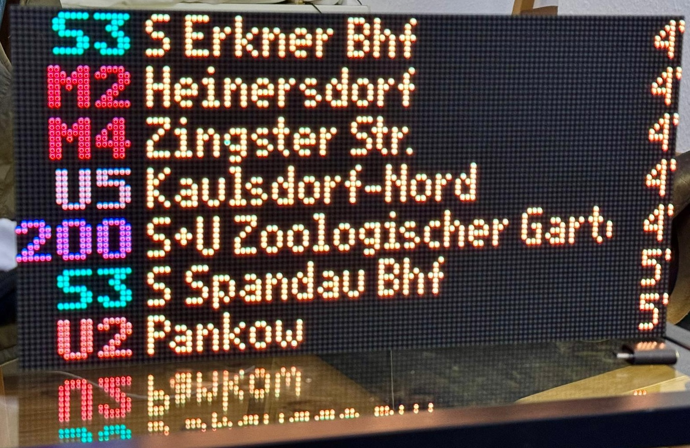

# BVG Departure Display

A real-time Berlin public transport (BVG) departure display built with a Raspberry Pi Pico W and HUB75 LED matrix panel. Shows upcoming departures with line numbers, destinations, and minutes until arrival in the distinctive BVG style.



## Features

- Real-time departure information from the [BVG REST API](https://v6.bvg.transport.rest)
- Colored display with authentic U-Bahn line colors
- Web-based configuration interface
- Access Point mode for initial WiFi setup
- Configurable station, transport types, and display options
- Filter specific lines from the display
- Walk delay to hide departures you can't catch

## Hardware Requirements

### Microcontroller (one of the following)

- **Raspberry Pi Pico W** (RP2040 + WiFi)
- **Raspberry Pi Pico 2 W** (RP2350 + WiFi)
- **Pimoroni Interstate 75 W** (recommended - includes HUB75 driver)
- Other RP2040/RP2350 boards with WiFi capability

### Display

- HUB75 LED matrix panel (supported sizes):
  - 128x32 (default)
  - 128x64
  - Other sizes supported by Interstate 75 with 32 or 64 pixel height

### Recommended Setup

The [Pimoroni Interstate 75 W](https://shop.pimoroni.com/products/interstate-75-w) is the easiest option as it combines the Pico W with a HUB75 driver board.

## Firmware

This project requires **Pimoroni MicroPython** (not standard MicroPython) as it uses the `hub75` and `picographics` libraries.

### Download Firmware

| Board | Firmware | Download |
|-------|----------|----------|
| Pico W / Interstate 75 W | Pimoroni MicroPython v1.25.0+ | [pimoroni-pico releases](https://github.com/pimoroni/pimoroni-pico/releases/latest) |
| Pico 2 W / Pico Plus 2 W | Pimoroni MicroPython v1.26.1+ | [pimoroni-pico-rp2350 releases](https://github.com/pimoroni/pimoroni-pico-rp2350/releases/latest) |

### Flashing Firmware

1. Download the appropriate `.uf2` file:
   - For **Pico W**: `picow-v1.x.x-pimoroni-micropython.uf2`
   - For **Pico 2 W**: `pico2_w-v1.x.x-pimoroni-micropython.uf2`
2. Hold the **BOOTSEL** button and connect USB (or tap **RESET** while holding BOOTSEL)
3. A drive called `RPI-RP2` will appear
4. Copy the `.uf2` file to the drive
5. The board will automatically restart

### Firmware with bvgdisp built in (Interstate 75 W with RP2350)

`firmware/build.sh` builds a MicroPython firmware with bvgdisp and the files in `src/assets/` (`index.html` and the PNGs) built in, so no files are needed on the device. The GitHub Actions workflow builds it on every push: download `bvgdisp-i75w_rp2350.uf2` from the run's artifacts, or from a release for tags. The firmware includes `Hub75SPWM` for panels with S-PWM driver chips such as the SM16380SH, from [ansiwen/pimoroni-pico](https://github.com/ansiwen/pimoroni-pico/tree/hub75-spwm).

- The built-in `hw_conf.py` is for a 128x64 panel with SM16380SH S-PWM driver chips and `COLOR_ORDER_RGB`. For other panels, put your own `hw_conf.py` on the device: files on the device take precedence over the built-in ones, so the same goes for the other modules and the files in `assets/`, eg. `assets/index.html`.
- Settings are stored in `/settings.json` on the device as before, and are kept when you flash a new firmware.
- Hold button A while powering on to get to the REPL instead of starting bvgdisp.
- If the device has bvgdisp's files from an earlier installation, delete them, except `settings.json` and a `hw_conf.py` of your own, otherwise they are used instead of the built-in ones.

To build it yourself, you need git, cmake, python3 and the ARM GCC toolchain (Ubuntu: `sudo apt install cmake gcc-arm-none-eabi libnewlib-arm-none-eabi`):

```bash
firmware/build.sh   # writes firmware/dist/bvgdisp-i75w_rp2350.uf2
```

The first build fetches the pinned MicroPython, Interstate 75 board and pimoroni-pico versions into `firmware/.deps` and takes several minutes. `firmware/manifest.py` lists what is built in.

## Installation

1. Flash the Pimoroni MicroPython firmware (see above)

2. Copy the the `src` directory to the Pico root directory:

3. Use a tool like [Thonny](https://thonny.org/), [mpremote](https://docs.micropython.org/en/latest/reference/mpremote.html), or [rshell](https://github.com/dhylands/rshell) to copy files.

   Example with mpremote:
   ```bash
   mpremote cp -r src :
   ```

## Configuration

### Hardware Configuration

Edit `hw_conf.py` to match your display:

```python
import hub75
import picographics

# Select your display size
DISPLAY = picographics.DISPLAY_INTERSTATE75_128X32
# DISPLAY = picographics.DISPLAY_INTERSTATE75_128X64

# Adjust if colors appear wrong (RGB vs RBG panels)
COLOR_ORDER = hub75.COLOR_ORDER_RGB
# COLOR_ORDER = hub75.COLOR_ORDER_RBG
```

Available display options:
- `DISPLAY_INTERSTATE75_128X32`
- `DISPLAY_INTERSTATE75_128X64`
- `DISPLAY_INTERSTATE75_192X64`
- `DISPLAY_INTERSTATE75_256X64`

Panels with S-PWM driver chips such as the SM16380SH need the firmware built by `firmware/build.sh`, and `PANEL` in `hw_conf.py`:

```python
PANEL = hub75.PANEL_SM16380SH
# SPWM_PROFILE = hub75.SM16380SH_REG8   # optional, the default is SM16380SH_REG2
```

Panels that aren't 1/32 scan with two halves also need their wiring, eg. a P2.5 128x64 1/64 scan panel with FM6373D drivers and a 6258K row driver:

```python
PANEL = hub75.PANEL_FM6373
SPWM_LANES = hub75.LANES_SINGLE                 # only R0, G0, B0
SPWM_ROW_DRIVER = hub75.ROWS_SHIFT_REGISTER     # the row driver is a shift register
```

### Initial Setup (Access Point Mode)

On first boot (or if WiFi credentials are not configured):

1. The display shows "WiFi Setup Mode"
2. Connect to the WiFi network **BVGdisplay** (open network)
3. Open `http://192.168.4.1` in your browser
4. Enter your WiFi credentials and select a station
5. Click **Save Settings** and then **Restart Device**

### Web Interface

Once connected to your WiFi, access the configuration page at `http://<device-ip>/`

Settings available:
- **WiFi SSID / Password** - Your WiFi network credentials
- **API URL** - BVG REST API endpoint (default: `https://v6.bvg.transport.rest`)
- **Station Search** - Search and select your departure station
- **Filtered Lines** - Hide specific lines (e.g., U5, S8)
- **Walk Delay** - Time in seconds to walk to the station (hides departures you can't catch)
- **Destination Offset** - Pixel offset for destination text alignment
- **Transport Types** - Enable/disable Bus, Tram, U-Bahn, S-Bahn, Regional, Express, Ferry
- **Colored Display** - Show transport type colors
- **Subway Line Colors** - Use authentic U-Bahn line colors (U1=green, U2=orange, etc.)

## Settings File

Settings are stored in `/settings.json` on the device. Default values:

```json
{
  "WIFI_SSID": "",
  "WIFI_PASSWORD": "",
  "API_URL": "https://v6.bvg.transport.rest",
  "STATION_ID": 900100003,
  "FILTERED": [],
  "WALK_DELAY": 0,
  "COLORED": true,
  "SUBWAY_COLORS": true,
  "SHOW_BUS": true,
  "SHOW_TRAM": true,
  "SHOW_SUBWAY": true,
  "SHOW_REGIONAL": true,
  "SHOW_SUBURBAN": true,
  "SHOW_FERRY": true,
  "SHOW_EXPRESS": true
}
```

## Troubleshooting

### Display shows "No WiFi configured"
The device couldn't find WiFi credentials. Connect to the **BVGdisplay** WiFi network and configure via the web interface.

### Display shows "Starting AP mode..." after connection failure
WiFi connection failed after multiple attempts. Check your SSID and password in the web interface.

### Colors appear wrong (red/blue swapped)
Change `COLOR_ORDER` in `hw_conf.py` between `COLOR_ORDER_RGB` and `COLOR_ORDER_RBG`.

### Noise or ghosting on an S-PWM panel
The chip registers don't suit your panel. Try another `SPWM_PROFILE` in `hw_conf.py`, eg. `hub75.SM16380SH_REG2` (the default) or `hub75.SM16380SH_REG1` (darker). On a P2.5 128x64 SM16380SH panel, REG7, REG32 and REG34 showed ghosting, and REG8 can show noise in large bright areas. On the FM6373D panel above, only `hub75.FM6373_REG6`, the default, showed no ghosting.

### No departures shown
- Check that your Station ID is correct
- Verify the API URL is accessible
- Ensure at least one transport type is enabled

## Dependencies

Included in Pimoroni MicroPython:
- `hub75` - HUB75 LED matrix driver
- `picographics` - Graphics library
- `pngdec` - PNG decoder for startup animation

## License

See [LICENSE](LICENSE) file.

## Links

- [Pimoroni MicroPython (RP2040)](https://github.com/pimoroni/pimoroni-pico/releases)
- [Pimoroni MicroPython (RP2350)](https://github.com/pimoroni/pimoroni-pico-rp2350/releases)
- [BVG REST API Documentation](https://v6.bvg.transport.rest/)
- [Interstate 75 W Product Page](https://shop.pimoroni.com/products/interstate-75-w)
